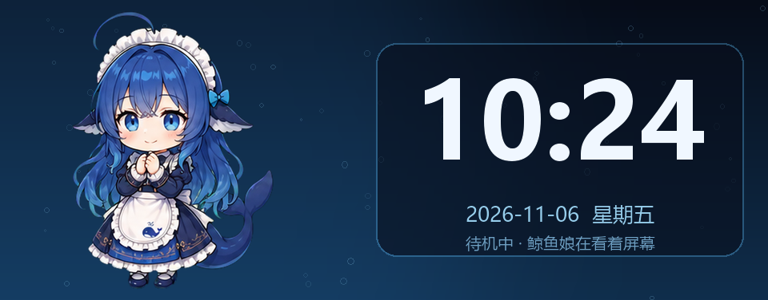
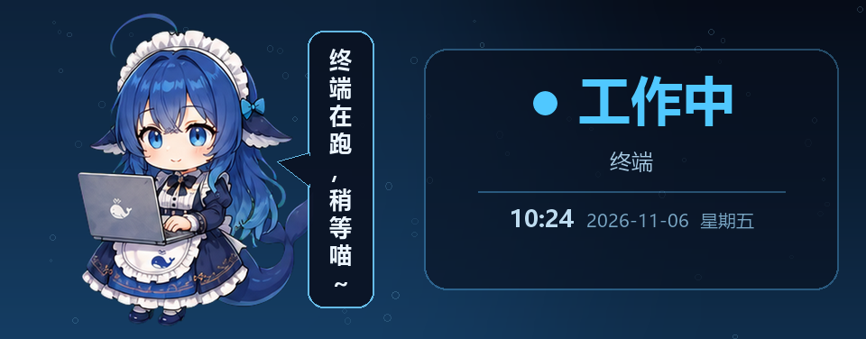
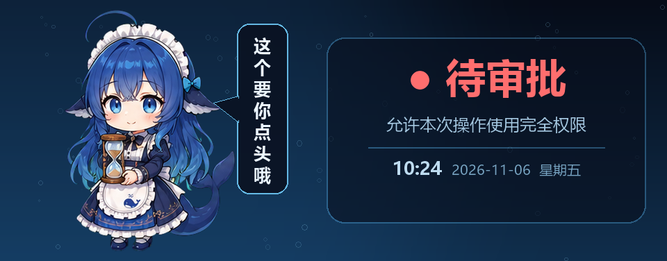

# JONSBO Whale Panel

> 把乔思伯 DS339（960×376）副屏变成一个会动的鲸鱼娘，并实时显示 DeepSeek Harness 的**工作中 / 待审批 / 等你回答**状态。

核心思路很简单：**JONSBO AIO 提供渲染和 USB 输出，我们用一个自定义主题当画布。**

- JONSBO AIO 每帧会读取主题目录下的 `data.png` / `source/data.png`；
- 本项目把「动画帧 + 状态卡 + 对话气泡」实时画进这张 PNG；
- 再通过一个本地 HTTP 接口和 DSH 插件，把「写什么」交给外部控制。

不需要驱动、不需要管理员权限、不修改 JONSBO AIO 的任何文件（只在主题目录里写图片）。

---

## 效果

| 状态 | 触发 | 画面 |
|---|---|---|
| 待机 | 无任务 | 时钟 + 21 个鲸鱼娘姿态轮播 + 动作台词 |
| 工作中 | 工具执行中 | `● 工作中 · 终端`（大号状态 + 小时间） |
| 待审批 | 审批弹窗 | 红色 `● 待审批` + 「这个要你点头哦」 |
| 等你回答 | 提问 | 黄色 `● 等你回答` + 「有个问题要你选～」 |
| 成功/失败 | 工具结束 | 3 秒瞬时气泡「搞定！」/「报错了…」 |

对话气泡是**竖排**（一字一行），一列最多 9 字，超了才接第二列（从左往右）。

| 待机 | 工作中 |
|---|---|
|  |  |
| **待审批** | **等你回答** |
|  |  |

> 这些图由 `whale/render_preview.py` 直接调用渲染函数生成，不是截图；改了布局可以重新生成。

---

## 原理

```
┌──────────────┐  POST /state  ┌──────────────┐   cmd.json   ┌──────────────┐
│ DSH 桥接插件  │ ────────────▶ │ 本地 HTTP API │ ───────────▶ │  daemon.py   │
│ (浏览器侧)    │               │ :8765        │  原子写入     │  渲染 960×376 │
└──────────────┘               └──────────────┘              └──────┬───────┘
                                                                     │ data.png
                                                                     ▼
                                                      ┌────────────────────────┐
                                                      │ Programme/WhaleGirl/    │
                                                      │   data.png              │
                                                      │   source/data.png       │
                                                      └───────────┬────────────┘
                                                                  │ 逐帧读取
                                                                  ▼
                                                          ┌──────────────┐
                                                          │  JONSBO AIO  │
                                                          └──────┬───────┘
                                                                 │ USB
                                                                 ▼
                                                          ┌──────────────┐
                                                          │  DS339 屏幕   │
                                                          └──────────────┘
```

关键点：**`source/data.png` 才是 JONSBO AIO 真正读取的文件**，根目录的 `data.png` 只是变更信号——所以播放器两份都写（根目录原子替换，source 直写）。

---

## 快速开始

### 0. 前置

| 依赖 | 说明 |
|---|---|
| Windows 10/11 | 本项目只支持 Windows（JONSBO AIO 仅 Windows） |
| [JONSBO AIO](https://www.screen-aio.com/) | 官方副屏管理软件，需要先装好并能正常显示主题 |
| Python 3.10+ | 需要 `Pillow`：`pip install pillow` |
| [dsh-whale-musume](https://github.com/Sutera-Diffusus/dsh-whale-musume) | 鲸鱼娘立绘素材（MIT），本项目不自带 |

### 1. 创建并注册主题

```powershell
cd whale
python make_theme.py
```

然后**重启 JONSBO AIO**，在主题列表里选择 `WhaleGirl`。

### 2. 启动播放器

```powershell
python daemon.py
```

或双击 `whale\start.bat`（无窗口）。此时副屏应该出现时钟 + 鲸鱼娘。

### 3. 安装 DSH 桥接插件（可选，但要自动联动必须装）

```powershell
cd bridge
python install_bridge.py
```

重启 DeepSeek Harness。之后副屏会自动跟随「工作中 / 审批 / 提问」变化。

卸载：`python uninstall_bridge.py`。

---

## 手动控制（不依赖 DSH）

```powershell
# 显示文字（默认 180 秒）
python whale\say.py "开会中" "14:00-15:00 勿扰" 600

# 显示图片
python whale\say.py --image C:\pics\a.png 30

# 回到待机
python whale\say.py --resume
```

HTTP 接口：

```powershell
Invoke-RestMethod -Uri http://127.0.0.1:8765/state -Method Post `
  -ContentType 'application/json' -Body '{"state":"approval","detail":"写文件权限"}'
```

接口清单见 [docs/03-api.md](docs/03-api.md)。

---

## 台词与姿态

- 台词库：`whale/lines.json`（按状态 / 姿态分桶，改完重启播放器生效）
- 姿态素材：来自 `dsh-whale-musume` 的 90+ 张立绘，播放器自动探测其安装路径
- 待机轮播：18 个姿态、约 267 秒一轮；每个姿态配一句台词

---

## 目录结构

```
jonsbo-whale-panel/
├─ whale/                 # 副屏播放器
│  ├─ daemon.py           # 渲染主循环 + 状态机
│  ├─ api.py              # 本地 HTTP 接口
│  ├─ config.py           # 路径自动探测 / 配置
│  ├─ make_theme.py       # 创建并注册自定义主题
│  ├─ say.py              # 命令行客户端
│  ├─ lines.json          # 台词库
│  └─ start.bat           # 无窗口启动
├─ bridge/                # DeepSeek Harness 客户端插件
│  └─ dsh-panel-bridge/
├─ docs/                  # 详细文档
└─ LICENSE / NOTICE
```

---

## 兼容性与声明

- 本项目与 **乔思伯（JONSBO）/ 海联智芯** 无任何关联，未经其授权；相关商标与软件著作权归其所有。
- 仓库不包含、也不分发 JONSBO AIO 的任何二进制、主题或素材。
- 本项目不修改、不破解该软件，不绕过任何授权或付费机制；它使用的是用户本地主题目录中的数据文件。
- JONSBO AIO 升级可能导致兼容性变化，请自行评估风险。
- 如权利方认为本仓库不妥，请通过 Issue 联系，我们会配合调整或下架。

立绘素材来自 [dsh-whale-musume](https://github.com/Sutera-Diffusus/dsh-whale-musume)（MIT，© Sutera-Diffusus），仓库只声明依赖、不分发。

---

## License

MIT，见 [LICENSE](LICENSE)。

